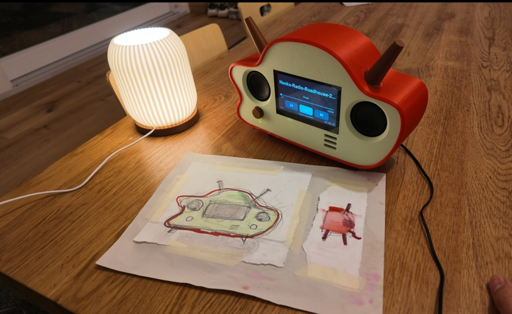
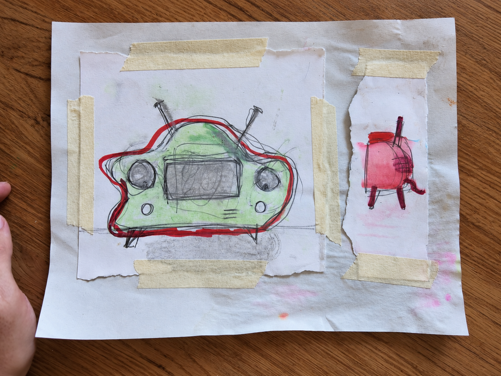
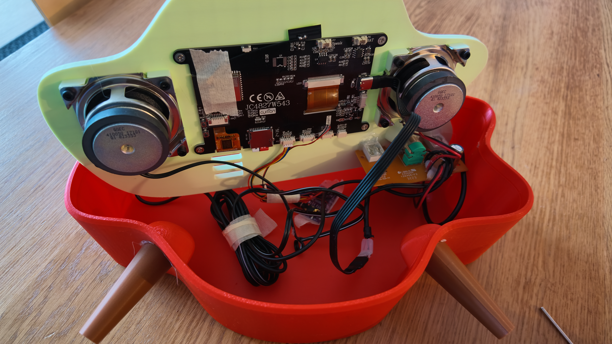
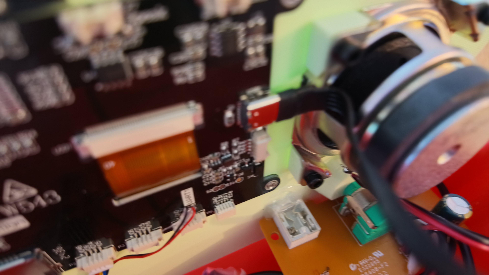
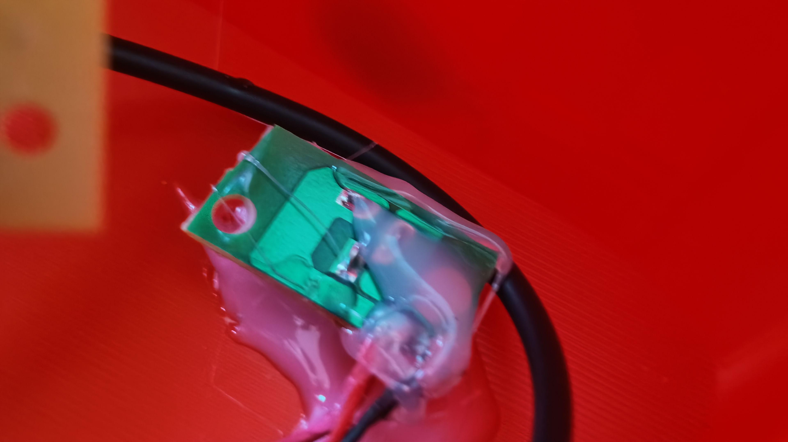

# An MP3 Player Designed by My Daughter

[Watch the video on YouTube](https://youtu.be/aMDl66ehtE4)

My daughter came up with this design at school and insisted that I bring it to life. And when I say insisted, I mean she directly supervised and micromanaged me throughout the entire build, to make sure I followed her very specific vision.

> Ok, turn it around. Hmmm, this curve that you promised, where is it?
> Yes, of course, the antenna is essential. You must put it.

Nothing passed without her confirmation. 

She also insisted that I should sell it, because apparently there are millions of people out there
just waiting to buy her design. I admire her confidence in her market research.

I hoped to show her that a design on paper can come to life with a little more help, and to expand her creative universe. I was happy to work with her and show her my workflow up close. And she was incredibly proud to see something she had imagined become a real, working object, exactly the way she wanted it. I would say job well done.

## She Thanked Me

She has a phone, and she can listen to music on it whenever she wants. My wife and I discussed for a while whether we should get her a Spotify subscription or something like that. But there was always a bit of... hmmmph. When music is so abundant, there's hardly any reason to listen to the same songs over and over again.

This player, on the other hand, is just MP3 files on a card. You put the music on it, and it plays. That's it. 

Later, she told me:

> Thanks, Dad. I like that I can listen to the music I chose, whenever I want, directly from the speaker. I can memorize the lyrics much better this way.

Apparently, there was a song that everyone among her friends was singing along to, repeating the lyrics together. It was important for her to memorize those lyrics so she could join in with her friends. And somehow, this little device helped her do that. I built it thinking it would be a fun little music player. I hadn't really thought about how it might help her feel more connected with her friends.

And I got a thank you for that.

That felt pretty good.

## What it does

**On the player,** you see the song, the artist and the album, with a timeline you can tap or drag. There are buttons for previous, play/pause and next. Tap the track name to browse the card and pick something else. It remembers where you were, even after a restart.

**A folder is a playlist.** Play a song and the rest of that folder follows in name order, then it starts over. So you can organize your music any way you like, and the songs you love come back around.

**From a browser on the same Wi-Fi,** you can control the player and manage the music: upload songs by drag and drop, have the player download a file from a link, and create folders, rename, move and delete. Software updates go the same way, with no cable needed.

## Build your own

### Bill of materials

| Part                                        | What it is for                                                                    |
| ------------------------------------------- | --------------------------------------------------------------------------------- |
| ESP32 S3 Board with Display **JC4827W543C** | The ESP32-S3 and 4.3" touch screen, on one board                                  |
| PCM5102A DAC module                         | Stereo audio out to the speakers                                                  |
| Logitech Z150 speakers                      | Taken apart for the internal speakers and the power supply                        |
| Micro SD card                               | Holds the MP3 files                                                               |
| Flat USB-C female to male connector         | Extends the port on the ESP32 board, since there is no room for a full USB-C plug |
| DIN 912 M3 hex screws, 5 mm long            | Hold the speakers and the ESP32 display                                           |
| M3 heat-set inserts, OD 4.5 mm, 3 mm long   | Go into the printed case, for those screws                                        |

I happened to have the Z150 speakers and wasn't using them, so I decided to take them apart and use them for the build.

The power is shared with the speakers. Their power supply has a 5V output, so I traced an extra wire from it to the ESP32 board.

The case is 3D printed, and the files are in [STL](STL) folder. The enclosure, display front, knob, legs, and antenna. The antenna is essential. You must put it.

### Setting it up

1. Install [PlatformIO](https://platformio.org/install/ide?install=vscode) in VS Code and open this folder.
2. Format a micro SD card as **FAT32** and put your MP3s on it, in whatever folders you like.
3. Connect the board over USB and run **PlatformIO: Upload** (or `pio run -t upload`). The first build downloads the toolchain and libraries.
4. Open the serial monitor (`pio device monitor`, 115200 baud) to see the IP address and any errors.
5. After that, updates can go over Wi-Fi: build (`pio run`) and upload `.pio/build/jc4827w543c/firmware.bin` under **Settings > Firmware**. Changes to the partition table (`partitions.csv`) still need a USB upload.

With no saved Wi-Fi network, the player starts its own access point, **MP3-Player** (password
`mp3player`). Join it, open `http://192.168.4.1`, and add your network under **Settings**. Several
networks can be saved; at startup the player joins whichever it can see, strongest first. They are
kept in `/config/wifi.json` on the card. An older `/wifi.txt` is imported automatically.

Once it is on your network, the web page is at `http://<ip shown on screen>` or `http://mp3player.local`.

## The technical details

Should be useful for those who want to build this for yourself.

### Hardware and pins

| Part               | Chip                                           | Pins                                          |
| ------------------ | ---------------------------------------------- | --------------------------------------------- |
| MCU                | ESP32-S3-WROOM-1 N4R8 (4 MB flash, 8 MB PSRAM) |                                               |
| Display            | NV3041A 480x272, QSPI                          | CS 45, SCK 47, D0-D3 21/48/40/39, backlight 1 |
| Touch              | GT911, I2C                                     | SDA 8, SCL 4, INT 3, RST 38                   |
| SD card            | SPI                                            | CS 10, MOSI 11, SCK 12, MISO 13               |
| Speaker            | NS4168 I2S amplifier (on board, mono)          | BCLK 42, LRCK 2, DOUT 41                      |
| Audio out (in use) | PCM5102A DAC module, stereo 3.5 mm jack        | BCK 9, LCK 5, DIN 14                          |

All pins are in [src/config.h](src/config.h).

### Wiring the PCM5102A

The three signal pins are not enough on their own. The firmware does not output a master clock, so **SCK must be tied to GND**. The DAC then generates its own clock from BCK. Some modules have a solder pad next to SCK that does the same thing.

| Module pin | Connect to |
| ---------- | ---------- |
| VIN        | 5V         |
| GND        | GND        |
| SCK        | GND        |
| BCK        | GPIO 9     |
| DIN        | GPIO 14    |
| LCK        | GPIO 5     |

The common purple modules also have four solder jumpers on the back. Each one has to be bridged to one side, or its input may be left floating, which can cause silence or distorted audio:

| Jumper | Function            | Bridge to | Setting            |
| ------ | ------------------- | --------- | ------------------ |
| H1L    | FLT (filter select) | L (low)   | Normal latency     |
| H2L    | DEMP (de-emphasis)  | L (low)   | Off                |
| H3L    | XSMT (soft mute)    | H (high)  | Not muted          |
| H4L    | FMT (audio format)  | L (low)   | I2S                |

---

The firmware was written by AI.
